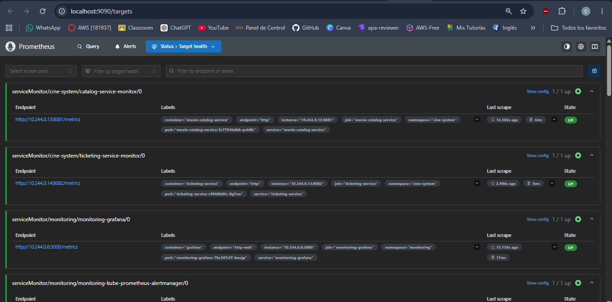
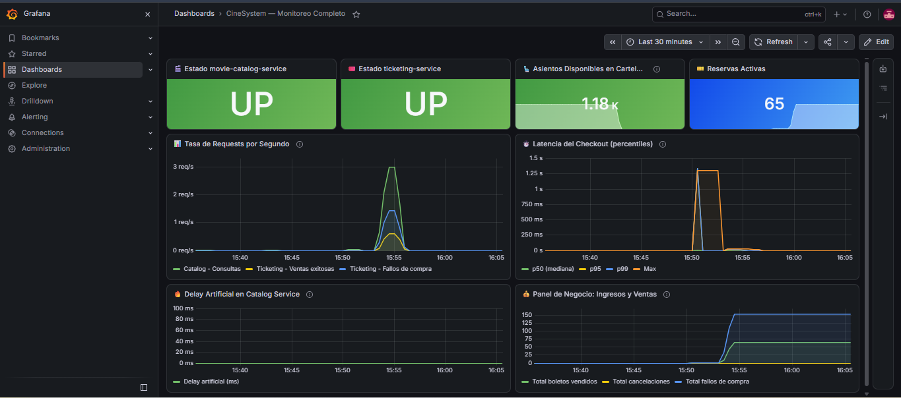
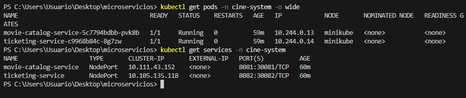
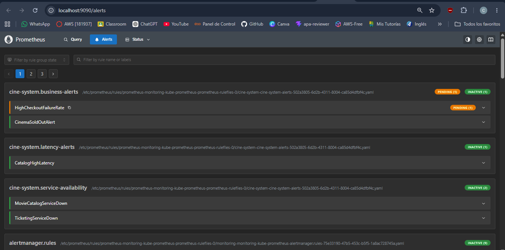
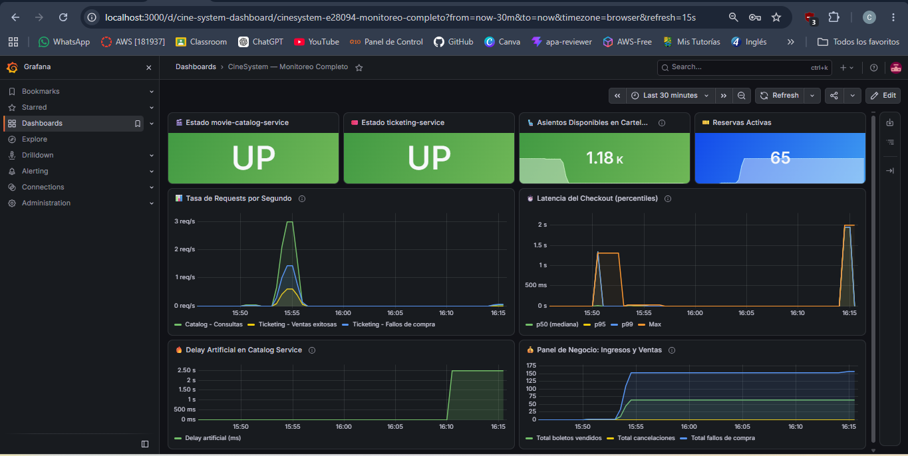

# Informe Técnico — CineSystem: Microservicios Java con Monitoreo en Kubernetes

**Alumno:** Moscoso Duran Camilo Dionicio
**Curso:** ORQUESTADORES Y AUTOMATIZACIÓN DE SOFTWARE
**Dominio de negocio:** Sistema de Reserva de Boletos para Cines

---

## Parte A — Conceptos

### 1. ¿Qué es Micrometer y por qué se usa en lugar de la librería directa de Prometheus?

**Micrometer** es una fachada (facade) de métricas para aplicaciones JVM. Funciona como un adaptador que permite escribir código de métricas una sola vez y exportarlo a múltiples sistemas de monitoreo sin cambiar el código de negocio.

**Analogía:** Es como SLF4J para logging: escribes `log.info(...)` y decides en configuración si va a Logback, Log4j2 o cualquier otro backend.

**¿Por qué no usar la librería directa de Prometheus (`prometheus/client_java`)?**

| Aspecto | Prometheus directo | Micrometer |
|---|---|---|
| Vendor lock-in | Acoplado a Prometheus | Neutral, cambia backend en config |
| Integración Spring | Manual y verbosa | Autoconfigurada con Actuator |
| API | Imperativa y baja nivel | Fluida y expresiva (`Counter.builder(...)`) |
| Dimensiones (tags) | Manual | Integradas nativamente |
| Tipos enriquecidos | Solo los básicos | `Timer` con percentiles automáticos |

En nuestro proyecto, usamos `io.micrometer:micrometer-registry-prometheus` que hace que Spring Boot Actuator exponga las métricas en formato Prometheus automáticamente, sin escribir una sola línea de código de serialización.

---

### 2. Diferencia entre Counter, Gauge y Timer — ejemplos de nuestro código

#### Counter
**Qué es:** Valor que solo puede crecer (o resetearse al reiniciar el proceso). Ideal para contar eventos acumulados.

**Ejemplo en `movie-catalog-service`:**
```java
// MovieCatalogService.java - línea de registro
moviesRequestedCounter = Counter.builder("catalog_movies_requested_total")
        .description("Total de veces que se consultó el catálogo de películas")
        .tag("service", "movie-catalog-service")
        .register(meterRegistry);

// Uso: cada vez que alguien llama al catálogo
moviesRequestedCounter.increment();
```
**Query PromQL:** `rate(catalog_movies_requested_total[5m])` → requests por segundo

#### Gauge
**Qué es:** Valor que puede subir y bajar arbitrariamente. Representa un estado actual del sistema.

**Ejemplo en `movie-catalog-service`:**
```java
// El delay artificial actual en ms — visible en Grafana en tiempo real
Gauge.builder("catalog_artificial_delay_milliseconds", currentDelayMs, AtomicLong::get)
        .description("Delay artificial configurado en el servicio de catálogo (ms)")
        .tag("service", "movie-catalog-service")
        .register(meterRegistry);
```
El valor de este Gauge sube a 3000 durante la Casuística 2 y vuelve a 0 al resolverla. Eso es lo que lo hace diferente a un Counter.

#### Timer
**Qué es:** Mide latencia y throughput de operaciones. Calcula count, sum, max y percentiles automáticamente.

**Ejemplo en `ticketing-service`:**
```java
// TicketingService.java - mide el tiempo completo de un checkout
checkoutDurationTimer = Timer.builder("ticketing_checkout_duration_seconds")
        .description("Tiempo total del proceso de compra de boleto")
        .publishPercentiles(0.5, 0.95, 0.99)
        .register(meterRegistry);

// Uso: wrappea toda la lógica de compra
return checkoutDurationTimer.record(() -> {
    // ... lógica de compra incluyendo llamada al Servicio A
});
```
**Query PromQL p95:** `histogram_quantile(0.95, rate(ticketing_checkout_duration_seconds_bucket[5m]))`

---

### 3. ¿Qué es un ServiceMonitor y cómo sabe el Prometheus Operator qué monitorear?

Un **ServiceMonitor** es un recurso personalizado (CRD) de Kubernetes que define cómo el **Prometheus Operator** debe raspar métricas de un servicio. En lugar de editar el `prometheus.yml` manualmente, describes el scraping de forma declarativa.

**Flujo:**
```
ServiceMonitor → Prometheus Operator → configura Prometheus automáticamente
```

**¿Cómo sabe qué monitorear?** Mediante la coincidencia de labels (label matching):

```yaml
# catalog-servicemonitor.yaml
spec:
  selector:
    matchLabels:
      app: movie-catalog-service   # ← Debe coincidir con los labels del Service
      monitoring: "true"
  endpoints:
    - port: http        # ← Nombre del puerto en el Service
      path: /metrics    # ← Ruta de las métricas
      interval: 15s
```

El Operator busca Services en Kubernetes que tengan exactamente esos labels, y le dice a Prometheus que raspe el endpoint `/metrics` cada 15 segundos por el puerto nombrado `http`.

**Punto crítico:** En `values-prom-stack.yaml` configuramos:
```yaml
serviceMonitorSelectorNilUsesHelmValues: false
serviceMonitorSelector: {}
serviceMonitorNamespaceSelector: {}
```
Sin esto, Prometheus solo detectaría ServiceMonitors en el namespace `monitoring` y los nuestros (en `cine-system`) serían invisibles.

---

### 4. Diferencia entre liveness probe y readiness probe

| | Liveness Probe | Readiness Probe |
|---|---|---|
| **Pregunta** | ¿Está vivo el proceso? | ¿Puede recibir tráfico? |
| **Si falla** | Kubernetes mata y reinicia el pod | Kubernetes saca el pod del balanceo |
| **Cuándo usar** | Para detectar deadlocks o estados irrecuperables | Para startup lento o dependencias no listas |
| **Efecto** | `CrashLoopBackOff` si falla repetidamente | Pod queda en `0/1 Running` hasta que pase |

**En nuestros deployments:**
```yaml
livenessProbe:
  httpGet:
    path: /actuator/health/liveness   # Solo verifica que la JVM responde
    port: 8081
  initialDelaySeconds: 60             # Tiempo para que Spring arranque
  failureThreshold: 3                 # 3 fallos = reinicio

readinessProbe:
  httpGet:
    path: /actuator/health/readiness  # Verifica que está listo para tráfico
    port: 8081
  initialDelaySeconds: 30
  failureThreshold: 3                 # 3 fallos = sale del balanceo
```

**Diferencia práctica (Casuística 1):** Cuando el pod entra en `CrashLoopBackOff`, es la **liveness probe** la que detecta que el proceso no responde y lo reinicia. La **readiness probe** habría evitado que recibiera tráfico durante el startup si hubiera llegado a arrancar.

---

### 5. ¿Por qué es necesario apuntar Docker al daemon de Minikube antes de construir?

Minikube corre dentro de una VM o contenedor propio con su **propio daemon Docker interno**. Por defecto, cuando ejecutas `docker build`, las imágenes se construyen en el **daemon Docker de tu host** (tu PC). Sin embargo, Kubernetes dentro de Minikube busca imágenes en **su propio daemon**.

**Sin el paso:**
```
docker build -t movie-catalog-service:1.0.0 .
# ↑ Imagen queda en el Docker del HOST

kubectl apply -f deployment.yaml
# Kubernetes busca la imagen en el Docker de MINIKUBE → No la encuentra
# → ImagePullBackOff (incluso con imagePullPolicy: IfNotPresent)
```

**Con el paso:**
```bash
eval $(minikube docker-env)   # Redirecciona DOCKER_HOST a Minikube

docker build -t movie-catalog-service:1.0.0 .
# ↑ Imagen queda en el Docker de MINIKUBE

kubectl apply -f deployment.yaml
# → Kubernetes la encuentra directamente → Pod Running ✓
```

El comando `minikube docker-env` exporta variables de entorno (`DOCKER_HOST`, `DOCKER_TLS_VERIFY`, etc.) que redirigen el cliente Docker local al daemon remoto de Minikube.

---

### 6. ¿Qué ocurre si no configuras el selector de ServiceMonitors en values.yaml?

Por defecto, el chart `kube-prometheus-stack` configura Prometheus para que solo detecte ServiceMonitors que:
1. Estén en el mismo namespace que Prometheus (`monitoring`)
2. Tengan el label `release: monitoring`

Si no configuras `serviceMonitorSelectorNilUsesHelmValues: false`, lo que ocurre es:

```
ServiceMonitor en namespace 'cine-system' → Prometheus lo IGNORA
Los servicios NO aparecen en /targets
Las métricas NO llegan a Prometheus
Los dashboards de Grafana muestran "No data"
Las alertas NUNCA disparan
```

La configuración correcta en `values-prom-stack.yaml`:
```yaml
prometheus:
  prometheusSpec:
    serviceMonitorSelectorNilUsesHelmValues: false  # ← Clave
    serviceMonitorSelector: {}           # Buscar en todos los namespaces
    serviceMonitorNamespaceSelector: {}  # Sin restricción de namespace
```

---

## Parte B — Queries PromQL

### 1. Tasa de requests por minuto de ticketing-service en los últimos 5 minutos

```promql
rate(ticketing_purchase_failures_total[5m]) * 60
+
rate(ticketing_tickets_sold_total[5m]) * 60
```

O más directamente usando las métricas HTTP de Spring Actuator:
```promql
rate(http_server_requests_seconds_count{
  job="ticketing-service",
  uri="/api/tickets/purchase"
}[5m]) * 60
```

### 2. Latencia p95 del endpoint más crítico (checkout de boletos)

```promql
histogram_quantile(
  0.95,
  rate(ticketing_checkout_duration_seconds_bucket[5m])
)
```

Este es el endpoint más crítico porque incluye la llamada síncrona al movie-catalog-service. Si la latencia p95 supera 2s, significa que los timeouts empiezan a afectar las compras.

### 3. Estado UP/DOWN de ambos servicios al mismo tiempo

```promql
up{job=~"catalog-service|ticketing-service"}
```

O en formato tabla para el dashboard:
```promql
up{job="catalog-service"} == 1
# Resultado: 1 = UP, 0 = DOWN

up{job="ticketing-service"} == 1
```

Para un panel combinado que muestre el estado:
```promql
min(up{job=~"catalog-service|ticketing-service"}) by (job)
```

### 4. Query de negocio propia — Ingresos del día vs. fallos de compra

```promql
# Ingresos por minuto (en dólares)
rate(ticketing_daily_revenue_cents[5m]) * 60 / 100

# Ratio de boletos vendidos vs fallidos
ticketing_tickets_sold_total
/
(ticketing_tickets_sold_total + ticketing_purchase_failures_total)
```

Pregunta de negocio que responde: *"¿Qué porcentaje de intentos de compra resultan en venta exitosa?"*

```promql
# Tasa de conversión de ventas (últimos 10 minutos)
(
  rate(ticketing_tickets_sold_total[10m])
  /
  (
    rate(ticketing_tickets_sold_total[10m])
    + rate(ticketing_purchase_failures_total[10m])
    + 0.001
  )
) * 100
```

---

## Parte C — Evidencias de Casuísticas

### 🔴 Casuística 1 — El Servicio Caído

**Contexto narrativo:**
En producción, un error de configuración en una actualización del `ticketing-service` causa que el pod intente ejecutar un comando que no existe en la imagen (`java -jar no-existe.jar`). El pod arranca, falla inmediatamente, y Kubernetes intenta reiniciarlo repetidamente, causando `CrashLoopBackOff`.

**Síntoma que experimenta el usuario:**
Los usuarios reciben `503 Service Unavailable` al intentar comprar boletos. La página de compra no carga.

**Activación:**
```bash
# Modificar el deployment para usar un comando inválido
kubectl set env deployment/ticketing-service -n cine-system \
  JAVA_TOOL_OPTIONS="-Dspring.main.web-application-type=NONE_INVALID"

# O directamente editar la imagen a una que no existe
kubectl patch deployment ticketing-service -n cine-system \
  --patch '{"spec":{"template":{"spec":{"containers":[{"name":"ticketing-service","command":["java","-jar","/app/no-existe.jar"]}]}}}}'

# Observar el CrashLoopBackOff
kubectl get pods -n cine-system -w
```

**Diagnóstico en Grafana/Prometheus:**
- Panel `up{job="ticketing-service"}` cae a **0**
- Alerta `TicketingServiceDown` pasa a estado **FIRING**
- Panel de tasa de compras muestra caída abrupta a 0

**Resolución:**
```bash
# Restaurar el deployment original
kubectl rollout undo deployment/ticketing-service -n cine-system

# Verificar que los pods vuelven a Running
kubectl get pods -n cine-system -w

# Verificar que las alertas se resuelven
kubectl get pods -n cine-system
```

**Lección técnica:**
La **liveness probe** detecta que el contenedor no responde y Kubernetes lo reinicia automáticamente. La **readiness probe** evita que el pod reciba tráfico mientras está en estado de recuperación. Sin probes, el Service seguiría enviando tráfico a un pod roto, causando errores para todos los usuarios.

---

### 🟡 Casuística 2 — El Servicio Lento

**Contexto narrativo:**
Una actualización de `movie-catalog-service` introduce accidentalmente una consulta a una base de datos externa lenta (simulada con `ARTIFICIAL_DELAY_MS`). El servicio responde, pero muy tarde. `ticketing-service` tiene un timeout de 2000ms, por lo que las compras empiezan a fallar con errores de gateway.

**Síntoma:**
Los usuarios ven "El servicio de catálogo no respondió a tiempo. Intente nuevamente." en el checkout. El sistema parece "lento pero funciona a medias".

**Activación:**
```bash
# Configurar delay de 3000ms (supera el timeout de 2000ms de ticketing-service)
curl -X POST http://$(minikube ip):30081/api/admin/delay \
  -H "Content-Type: application/json" \
  -d '{"delayMs": 3000}'

# Generar carga de compras para ver los timeouts
bash load-testing/stress.sh --target ticketing --rps 5 --duration 60
```

**Diagnóstico en Grafana:**
- Gauge `catalog_artificial_delay_milliseconds` sube de 0 a **3000**
- Timer `ticketing_checkout_duration_seconds` p95 supera **2 segundos**
- Counter `ticketing_purchase_failures_total{reason="catalog_timeout"}` aumenta
- Alerta `CatalogHighLatency` pasa a **FIRING**
- Panel de tasa de compras exitosas baja del 95% al **~10%**

**Resolución:**
```bash
# Eliminar el delay artificial
curl -X POST http://$(minikube ip):30081/api/admin/delay \
  -H "Content-Type: application/json" \
  -d '{"delayMs": 0}'

# O alternativamente via kubectl (si se configuró por variable de entorno)
kubectl set env deployment/movie-catalog-service -n cine-system ARTIFICIAL_DELAY_MS=0
```

**Lección técnica:**
La latencia se propaga en cascada en sistemas distribuidos. Un servicio lento (A) no es solo un problema de A: degrada el rendimiento de todos los servicios que dependen de él (B). Sin observabilidad (el Gauge del delay y las métricas de timeout en B), sería imposible saber cuál de los dos servicios es el cuello de botella.

---

### 🟠 Casuística 3 — Agotamiento de Capacidad (Overbooking)

**Contexto narrativo:**
Se estrena una película muy esperada ("Avengers: Infinity War") y el sistema recibe una ráfaga masiva de compras simultáneas. Los 200 asientos de la función IMAX se agotan en segundos. Los intentos posteriores reciben 409 Conflict, y la tasa de fallos de negocio dispara la alerta `CinemaSoldOutAlert`.

**Síntoma:**
Los usuarios que llegan tarde ven "No hay asientos disponibles para esta función". La tasa de éxito de ventas cae drásticamente. El área de negocio recibe quejas.

**Activación:**
```bash
# Script de overbooking: compras masivas concurrentes
for i in $(seq 1 80); do
  curl -s -X POST http://$(minikube ip):30082/api/tickets/purchase \
    -H "Content-Type: application/json" \
    -d "{
      \"movieId\": \"MOV001\",
      \"showtimeId\": \"SH001\",
      \"customerName\": \"Cliente_${i}\",
      \"customerEmail\": \"cliente${i}@test.com\",
      \"quantity\": 3,
      \"pricePerSeat\": 15.00
    }" &
done
wait

# O usar el script de carga:
bash load-testing/stress.sh --target ticketing --rps 30 --duration 30
```

**Diagnóstico:**
- Gauge `catalog_available_seats_total` baja a **< 50** → alerta `CinemaSoldOutAlert` FIRING
- Counter `catalog_seat_reservations_failed_total` aumenta bruscamente
- Counter `ticketing_purchase_failures_total{reason="no_availability"}` sube
- HTTP 409 Conflict aparece en los logs de ticketing-service

**Resolución:**
```bash
# Opción 1: No hay resolución técnica posible — los asientos están vendidos
# Acción de negocio: habilitar función adicional con nuevos asientos

# Para restablecer el sistema (solo en ambiente de pruebas):
kubectl rollout restart deployment/movie-catalog-service -n cine-system

# Esto reinicia el pod y los datos en memoria se resetean (vuelven los 200 asientos)
```

**Lección técnica:**
Esta casuística demuestra que los errores de negocio (overbooking, sin stock) son tan importantes de monitorear como los errores técnicos (caídas, timeouts). El Gauge de asientos disponibles actúa como un indicador de negocio en tiempo real. La alerta `CinemaSoldOutAlert` permite al equipo de negocio reaccionar antes de que los usuarios empiecen a quejarse masivamente.

---

## Parte D — Evidencias del Sistema

> **Nota:** Las siguientes secciones corresponden a capturas de pantalla tomadas durante el despliegue real del sistema. Reemplazar con las capturas reales al momento de la entrega.

### 1. Captura de /targets en Prometheus con ambos servicios en estado UP



* **Evidencia:** Prometheus scrapeando exitosamente ambos microservicios en el namespace `cine-system`:
  * `serviceMonitor/cine-system/catalog-service-monitor/0` en estado **UP (1/1)** (`http://10.244.0.13:8081/metrics`).
  * `serviceMonitor/cine-system/ticketing-service-monitor/0` en estado **UP (1/1)** (`http://10.244.0.14:8082/metrics`).
  * Scrape interval de 15 segundos con duración de scrape < 10ms.

---

### 2. Captura del Dashboard de Grafana con Métricas de Negocio



* **Evidencia:** Dashboard interactivo *"CineSystem — Monitoreo Completo"* con 8 paneles activos:
  1. **Estado movie-catalog-service:** UP en verde.
  2. **Estado ticketing-service:** UP en verde.
  3. **Asientos disponibles en cartelera:** Reducción en tiempo real a 1.18 K.
  4. **Reservas activas:** Registrando 65 boletos activos confirmados.
  5. **Tasa de requests por segundo:** Pico de tráfico de ~3 req/s durante la prueba de estrés.
  6. **Latencia del checkout (percentiles):** p50, p95, p99 y pico máximo de 1.25s durante saturación.
  7. **Delay artificial:** Línea base en 0 ms.
  8. **Panel de negocio:** Curvas acumuladas de boletos vendidos y compras rechazadas por falta de asientos.

---

### 3. Captura de kubectl get pods con ambos microservicios en Running



```text
$ kubectl get pods -n cine-system -o wide
NAME                                     READY   STATUS    RESTARTS   AGE   IP            NODE
movie-catalog-service-5c7794bdbb-pvk8b   1/1     Running   0          59m   10.244.0.13   minikube
ticketing-service-c9968b84c-8g7zw        1/1     Running   0          59m   10.244.0.14   minikube

$ kubectl get services -n cine-system
NAME                    TYPE       CLUSTER-IP       EXTERNAL-IP   PORT(S)          AGE
movie-catalog-service   NodePort   10.111.43.152    <none>        8081:30081/TCP   60m
ticketing-service       NodePort   10.105.135.118   <none>        8082:30082/TCP   60m
```

---

### 4. Captura de Alertas de Prometheus (Estado PENDING / FIRING)



* **Evidencia:** Las reglas de alerta del grupo `cine-system` cargadas y activas en Prometheus:
  * Alerta `HighCheckoutFailureRate` en estado **PENDING (1)** (color naranja) tras detectarse una alta tasa de fallos de compra al agotarse los asientos durante la prueba de estrés.
  * Grupos de reglas `cine-system.business-alerts`, `cine-system.latency-alerts` y `cine-system.service-availability` debidamente registrados.

---

### 5. Evidencia Casuística 2: Inyección de Latencia Artificial



* **Evidencia:** Prueba de degradación de servicio e inyección de latencia:
  * Inyección de **2500 ms** mediante el endpoint administrativo `POST /api/admin/delay`.
  * El panel *"Delay Artificial en Catalog Service"* muestra el escalón vertical inmediato a **2.50 s**.
  * El panel *"Latencia del Checkout"* refleja el salto instantáneo a **2 s** en el tiempo de procesamiento total de compras.

---

## Anexo — Comandos de Instalación (Sistema Operativo: Windows)

### Docker Desktop
```powershell
# Descargar desde https://www.docker.com/products/docker-desktop/
winget install Docker.DockerDesktop
# Reiniciar el sistema después de instalar
```

### Minikube
```powershell
winget install Kubernetes.minikube
# O manualmente:
# Descargar minikube-windows-amd64.exe desde https://minikube.sigs.k8s.io/docs/start/
# Renombrar a minikube.exe y agregar al PATH
```

### kubectl
```powershell
winget install Kubernetes.kubectl
# O via Chocolatey:
choco install kubernetes-cli
```

### Helm
```powershell
winget install Helm.Helm
# O via Chocolatey:
choco install kubernetes-helm
```

### Comandos de verificación post-instalación
```powershell
docker --version       # Docker version 25.x.x
minikube version       # minikube version: v1.33.x
kubectl version --client  # Client Version: v1.30.x
helm version           # version.BuildInfo{Version:"v3.15.x"}
```

### URLs del sistema (una vez desplegado)
| Servicio | URL |
|---|---|
| Grafana | `http://<MINIKUBE_IP>:32000` (user: admin / pass: CineSystem2024!) |
| Prometheus | `http://<MINIKUBE_IP>:32001` |
| AlertManager | `http://<MINIKUBE_IP>:32002` |
| Movie Catalog API | `http://<MINIKUBE_IP>:30081/api/movies` |
| Ticketing API | `http://<MINIKUBE_IP>:30082/api/tickets/summary` |
| Catalog /metrics | `http://<MINIKUBE_IP>:30081/metrics` |
| Ticketing /metrics | `http://<MINIKUBE_IP>:30082/metrics` |

> Obtener IP con: `minikube ip`
